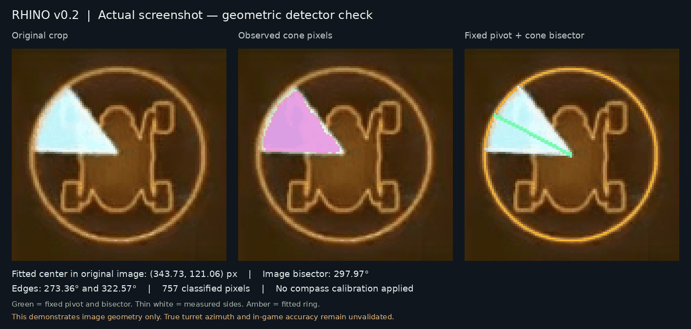

# Rhino Turret Compass

**v0.2.2-beta.1 · Experimental community beta · Windows x64 · Python 3.12**

A floating compass for the **Rhino SRV turret in Elite Dangerous**. Point the turret toward a landmark, surface contact, or resource deposit and read an estimated compass bearing without rotating the entire vehicle.

The application reads the cyan field-of-view cone in the circular turret HUD. The orange ring defines a fixed pivot; the two cone boundaries define the viewing direction. A manually entered chassis heading and a short forward/right calibration turn that direction into an estimated world bearing.



## Download

Open [Releases](https://github.com/erichards2222-maker/Rhino-turret-compass-v2/releases) and download the named **Beta_SOURCE.zip** asset. It includes the application, instructions, examples and tests. The release is marked **Pre-release**, not a stable release. The repository name ends in `v2` to distinguish this distribution repository; the application version is shown above.

This is inspectable Python source, not a packaged executable. Setup installs the declared dependencies; Python 3.12 x64 must already be available.

## Install and run

1. Extract the ZIP into a **short, writable folder**, for example `%USERPROFILE%\RTC`. Open the folder containing `Setup_Beta.cmd`; do not run from inside the ZIP. That folder's complete path must be no longer than 70 characters because a dependency contains deeply nested resources.
2. Install [Python 3.12 x64 for Windows](https://www.python.org/downloads/windows/) if needed. Confirm `py -3.12 --version` in a normal terminal.
3. Run **Setup_Beta.cmd**. It creates a local `.venv` and installs three pinned, hash-checked dependencies from PyPI. Leave checksum verification enabled. Run as an ordinary user.
4. Run **Verify_Package.cmd**, **Run_Tests.cmd**, and **Run_UI_Check.cmd**. Resolve any failure before live use.
5. Run **Run_Beta.cmd**, then choose **Open supplied sample**. The sample should show an image-relative bisector near **298°**; that is not a known game heading.

The normal application processes selected screen pixels locally. Setup uses the internet to download dependencies. Images are written only when you choose to save a diagnostic. Do not copy an existing `.venv` between installation paths.

For illustrated instructions, open **START_HERE.html** in the extracted folder. [COMMUNITY_BETA.md](COMMUNITY_BETA.md) is the shorter field checklist.

## Calibrate once at each stationary stop

Park on approximately **level ground**, stop fully, and note the normal chassis compass heading. Enter turret view.

Choose the monitor and **Choose LIVE region**. Select only the rightmost circular Rhino indicator: include its entire orange perimeter and a small margin, excluding adjacent gauges and panel borders. Borderless display mode is recommended for the first test. Keep other windows away from the selected region.

Inspect the orange fitted circle, green pivot, and cone centerline. Choose **Lock ring — center is correct** only if the fit is visibly correct. The crop itself need not be perfectly centered.

Enter **Chassis heading** from 0 up to, but not including, 360. Point the turret straight along the Rhino's nose and choose **Set FORWARD reference**. Turn only the turret about 90° right and choose **Check RIGHT turn**. This establishes the direction sign, not a precision 90° measurement. Confirm the stationary/level conditions.

Pan through a complete turn. The pivot should stay fixed, the line should bisect the cone, and pointing forward should return approximately to the entered chassis heading. Center the actual target marker before reading its bearing.

## Read, copy, and reset

The main window and optional floating display show the estimated bearing. **Freeze & COPY bearing now** captures a fresh reading. The optional **Ctrl+Alt+B** shortcut operates while Elite has focus. The clipboard contains the number only; any quality warning must be recorded separately. On an invalid reading, the clipboard is left unchanged and the interface says **NOT COPIED**. A previous copied value is not a live reading.

**[CAUTION]** means the free-edge apex differs modestly from the fixed ring pivot while the independent consistency checks still agree. Verify such readings against a known heading before relying on them. Strong disagreement, ambiguous sectors, or ring movement suppress the estimate rather than moving the pivot.

After chassis movement, turning, sliding, or redeployment, choose **I moved the Rhino — invalidate anchor** and recalibrate. Also recalibrate after changes to resolution, display scaling, monitor layout, or HUD position. The program cannot establish that the chassis remained motionless. Calibration is session-only.

## Uses and interoperability

Use the compass for bearings to landmarks, surface contacts, survey points, or nearby deposits, or as an input to a calculator that explicitly accepts a manually entered bearing. The compass does not calculate a target's range or geographic coordinates. It does not automatically supply readings to another application. Other developers may integrate the code or implement the approach in their own tools under the license below.

## Accuracy and beta limits

This is a navigation aid, **not a calibrated survey instrument**. One user's live testing found a working turret sweep and one same-target comparison of 293° estimated versus 292° chassis-aligned. One comparison is not an accuracy distribution or a guaranteed ±1° result. Automated image tests and offscreen interface tests do not qualify every Windows display, physical hotkey interaction, terrain slope, or HUD configuration.

At 2 km, angular differences of 1°, 2°, and 3° alone correspond to roughly 35 m, 70 m, and 105 m between equal-range endpoints. Position, range, elevation, vehicle tilt and target-centering errors are additional. Axis-aligned image scaling is handled; full vehicle-attitude correction is not.

Stop using a reading if the pivot is misplaced, the line leaves the cone center, direction reverses, or an obscured indicator produces a plausible false bearing.

## Diagnostics and support

**Save diagnostic snapshot…** freezes a crop before opening the save dialog. A new basename produces `.raw.png`, `.preview.png`, and `.json`; existing files are not overwritten. Review every image before sharing. Keep the selection confined to the indicator, and remove usernames or local paths from error reports.

Use [Issues](https://github.com/erichards2222-maker/Rhino-turret-compass-v2/issues) for reproducible problems. Include the version, Windows version, resolution/scaling, steps, expected and actual behavior, and a reviewed indicator crop when useful. Do not send an entire game screen when a small crop is sufficient.

| Problem | First check |
|---|---|
| Python unavailable | Install Python 3.12 x64 and check `py -3.12 --version`. |
| Path rejected | Extract into a shorter folder; do not reuse a partly installed environment. |
| Dependency/hash failure | Keep the error and stop; do not remove the pinned hashes. |
| Black or obstructed capture | Try Borderless mode and move covering windows. |
| Ring missing or shifted | Reselect the complete ring with a narrow margin; recalibrate. |
| Bearing unavailable | Read the displayed reason and check calibration, confirmation and cone geometry. |
| Hotkey unavailable | Leave it disabled or resolve the key conflict; use the copy button. |

## Development and tests

See [CONTRIBUTING.md](CONTRIBUTING.md). The Windows CI runs unit tests, Qt static-image checks, 360 clean images, 240 degraded images, 144 deliberate invalids and 432 apex/shifted-origin stress cases. It builds a source ZIP, extracts it into a new directory and repeats the checks.

```powershell
.venv\Scripts\python.exe -B tools\verify_package.py
.venv\Scripts\python.exe -B -m unittest discover -s tests -v
.venv\Scripts\python.exe -B tools\gui_smoke.py
.venv\Scripts\python.exe -B tools\run_matrix.py clean --output test-output
.venv\Scripts\python.exe -B tools\run_matrix.py degraded --output test-output
.venv\Scripts\python.exe -B tools\run_matrix.py adversarial --output test-output
.venv\Scripts\python.exe -B tools\run_matrix.py apex --output test-output
```

Generated results and local environments belong outside tracked source. After intentional edits, regenerate the manifest with `python tools/update_manifest.py`, review the diff and rerun verification. Hashes verify consistency, not publisher identity or runtime safety.

## License and credit

Code and documentation are **MIT-licensed**; see [LICENSE](LICENSE). You may use, adapt and incorporate them while retaining the required copyright/license notice. A visible acknowledgement of **CMDR Rhino / Rhino Turret Compass** is appreciated when the code or concept is useful; this is a courtesy request, not an extra license condition.

Thanks to **Armchair** for the surveying discussion that inspired the tool. It is a standalone companion for general use. Game artwork and dependency notices are in [NOTICE.md](NOTICE.md).
